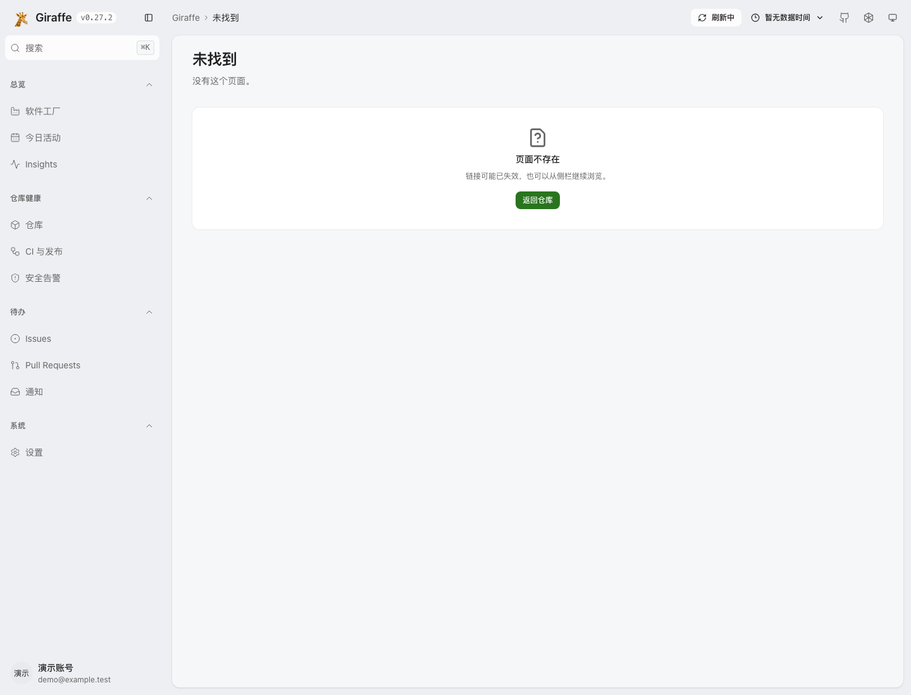
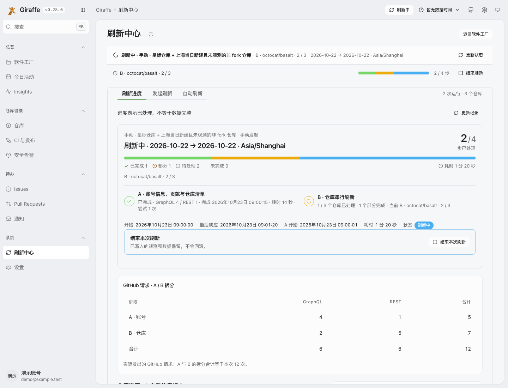
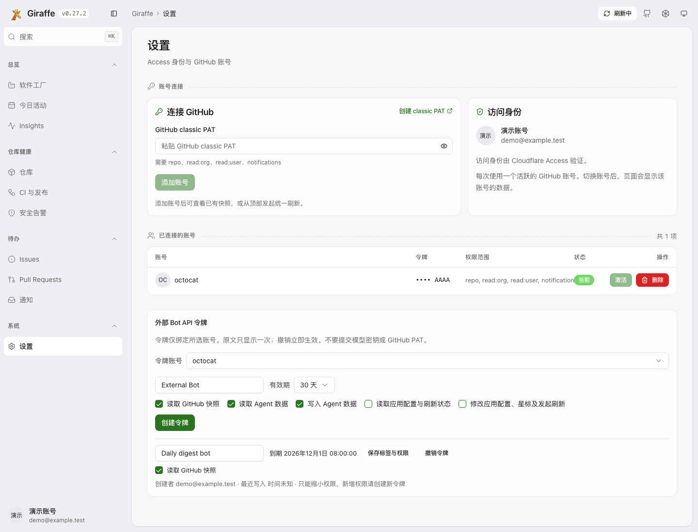
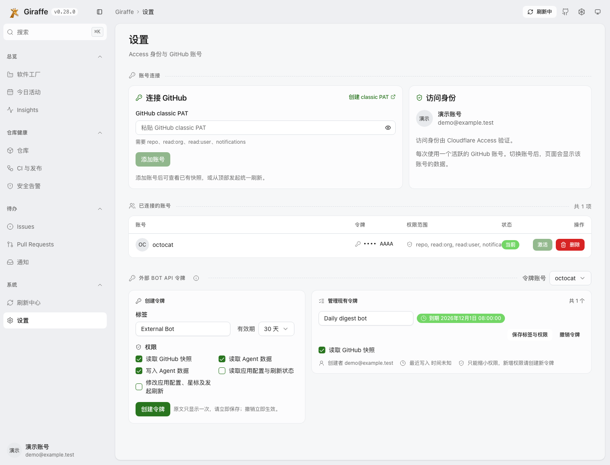
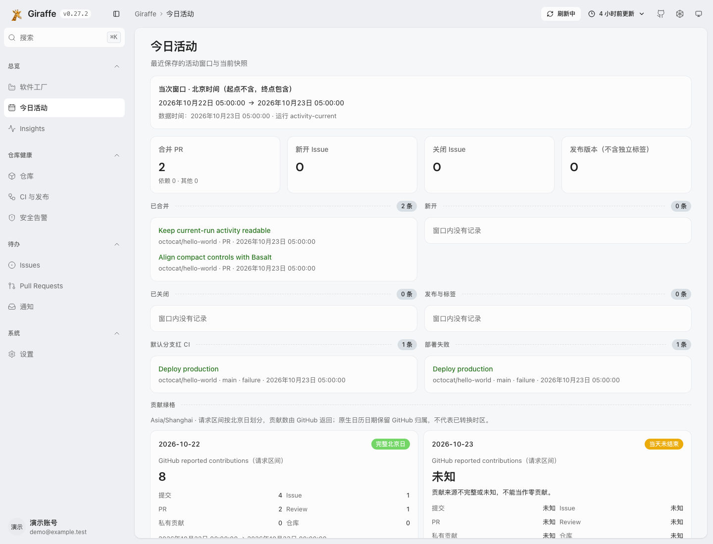
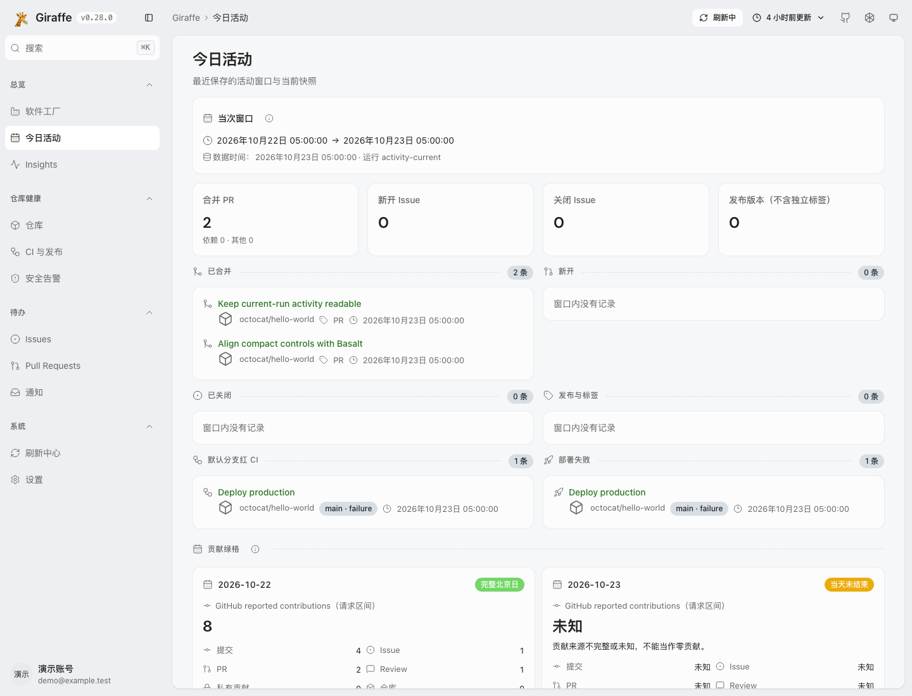
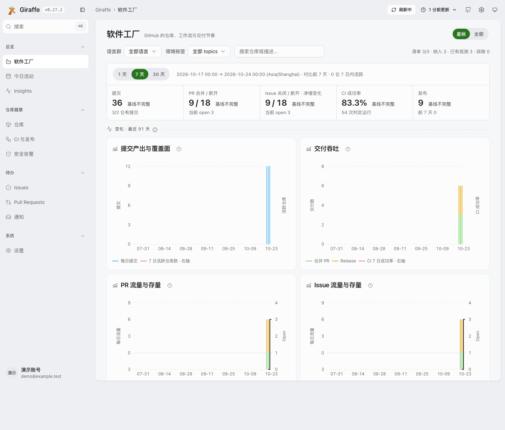
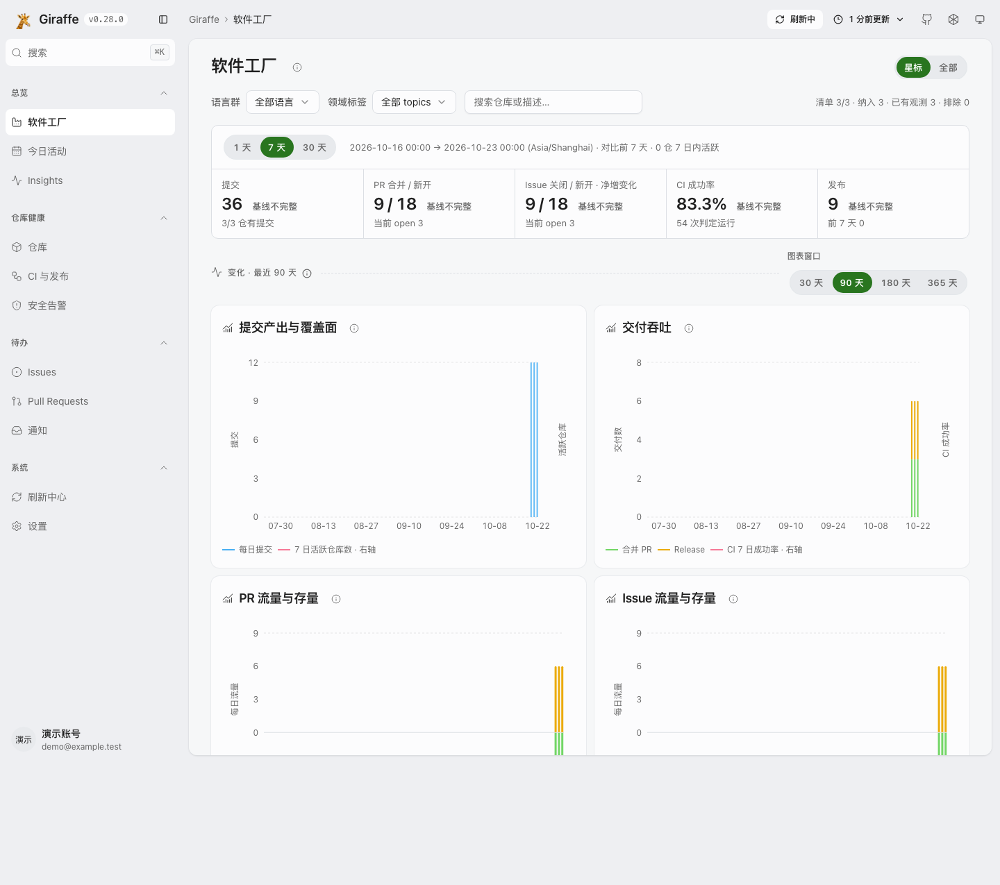

# UI 0.28.0 visual evidence

Baseline: `b3ddaa573828aa080620cef17e396403b432bc58` (v0.27.2).
Candidate client tree: `ce0060f06149dde8c515b1f2a0ab599dff3d377e` (v0.28.0).
Integration base: `6ad6eb78113e2f18cc0a4b4c0d0dc7ee02c75808` (v0.27.4).

The client tree is the Git tree object at `HEAD:apps/web/src/client`, pinning the
captured UI independently of this evidence document's containing commit.

The original before captures remain pinned to v0.27.2. After captures include
the post-rebase settlement corrections: cancellation closure is not successful
collection, and processed dimensions do not imply available observations.
Diagnostic help uses the same closure semantics. Narrow repository panels reflow
dimension chips without squeezing repository identities into vertical text.
Fresh integration gates exercise the v0.27.4 Worker with this corrected UI tree.
Terminal-unavailable days can be settled cache windows without becoming available
measurements; unavailable status, zero observed days and null counts stay intact.
The client rejects unavailable coverage when projecting measurement availability
and complete observation days, even when settled cache windows are present.
Mixed available/unavailable alert streams remain observed, but their settlement
windows do not identify which dates have complete measurements. Daily alert
completeness therefore remains unknown unless overall alert coverage is complete;
partial flow streams retain their individually complete day windows.
An alert stream with zero observed days and only terminal settlement windows
remains unobserved even when another day's temporary failure makes it partial.

Chromium captures use the same fixed clock, saved API fixtures and localhost-only
static SPA hosts. No production request or real credential is involved.
The baseline `/refresh` intentionally shows the missing-page state; the restored
layout references historical source at `8f3d819f`.

| Surface          | Before                                          | After                                         |
| ---------------- | ----------------------------------------------- | --------------------------------------------- |
| Refresh Center   |    |    |
| Token settings   |  |  |
| Today activity   |     |     |
| Software Factory |    |    |

Desktop captures use a 1440 × 1100 CSS-pixel viewport and light theme.
The corresponding `*-mobile-dark.png` files use 390 × 844 and dark theme.
Refresh detail captures show per-repository progress and the keyboard-scrollable
history table below the initial viewport. All four theme/viewport combinations
are exercised by `tests/e2e/ui-refresh-review.spec.ts`; the committed selection
keeps representative evidence rather than every intermediate run.

Supplementary mobile-dark captures cover the lower sections:
- [Token creation and existing-token management](after-settings-tokens-mobile-dark.png)
- [Factory chart windows and missing-day rendering](after-factory-charts-mobile-dark.png)
- [Refresh dimensions, reasons and history](after-refresh-details-mobile-dark.png)

Post-rebase semantic regressions have dedicated browser captures:
- [Cancelled account closure without settled collection](after-cancelled-account.png)
- [Processed dimensions without claiming complete observations](after-settled-dimensions.png)

These supplemental captures use 1280 × 720, light theme and the same fixed clock.
The settled-dimension journey asserts at least 160px of repository identity width
and at most 120px of summary height inside the desktop two-column layout.

The browser journey checks that dimension labels and their repository rows do not
overflow at both viewport widths and in both themes. Project-identity journeys
retain the established 24px marks in secondary lists.

Run the full local browser lane with `bun run test:e2e:bdd` after reserving its
fixed ports. The screenshot journey only reads intercepted API fixtures; the
separate refresh-center interaction journey intercepts its cancellation request.
